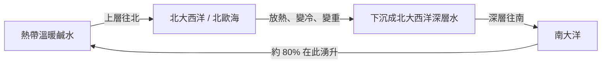

# 大西洋經向翻轉環流（AMOC）

> AMOC 是大西洋的主要洋流系統：溫暖的鹹水在上層往北流，到了北大西洋冷卻下沉，再以冷的深層水往南回流。它佔全球溫鹽環流的一半，讓西北歐比同緯度地區溫暖 4–10°C（[[src-amoc-noaa-wikipedia|AMOC 資料]]）。

## 怎麼運作

- 深層水主要在北歐海（Nordic Seas）形成；拉布拉多海的角色仍有爭議（[[src-amoc-noaa-wikipedia|AMOC 資料]]）。
- 它是[[ocean-currents|溫鹽環流「全球輸送帶」]]在大西洋的部分；整個輸送帶繞一圈約 1,000 年（[[src-noaa-ocean-currents|NOAA 洋流]]）。

## 和墨西哥灣流的關係
常有人把兩者混為一談。[[gulf-stream|墨西哥灣流]]整體是風驅動的表層流；但它的北段（北大西洋暖流）有很大一部分熱量來自 AMOC。AMOC 最多把 25% 的熱量送往北半球，大西洋也是唯一一個熱量往北輸送的海洋（[[src-amoc-noaa-wikipedia|AMOC 資料]]）。

## 怎麼量測
2004 年起，北緯 26° 的 RAPID 浮標陣列直接量測 AMOC；模式估計 20 世紀後期的強度約 14–26 Sv（[[src-amoc-noaa-wikipedia|AMOC 資料]]，摘要部分）。

## 它在變弱嗎？
> [!question] 爭議
> - **可能在變弱**：重建資料顯示 2015 年的 AMOC 比工業革命前弱；有研究估計約減弱 15%，或自 1950 年起每十年減少 0.46 Sv。可能原因是海洋暖化與格陵蘭融冰的淡水注入。
> - **不一定**：也有研究認為 1980 年以前沒有變化、之後的減弱仍在自然變動範圍內；佛羅里達海流 40 年的觀測顯示穩定。
> - **IPCC AR6（2021）**：21 世紀「很可能」減弱（高信心）；2100 年前崩潰「不在預期中」（中等信心）。
> （以上皆出自 [[src-amoc-noaa-wikipedia|AMOC 資料]]，大多為維基摘要，未核對原始論文）

## 會不會崩潰（臨界點）
| 研究 | 結論 |
|---|---|
| Armstrong McKay 等（2022） | 最可能在升溫約 4°C 時觸發（範圍 1.4–8°C），之後 15–300 年內崩潰 |
| Ditlevsen 與 Ditlevsen（2023） | 最可能約 2065 年崩潰（95% 範圍 2037–2109）；許多學者存疑 |
| Baker 等（2025，Nature） | 34 個模式都相當穩健，21 世紀崩潰不太可能 |
| 2026 年高解析度模擬 | 崩潰可能比先前認為的更容易發生 |

（[[src-amoc-noaa-wikipedia|AMOC 資料]]）各研究差異很大，這仍是科學界激烈辯論的題目。

## 過去發生過
- **新仙女木期**（約 1.28–1.17 萬年前）：勞倫泰德冰蓋融冰水大量注入北大西洋，AMOC 突然減弱，北半球可能在十年內回到接近冰期的低溫（[[src-amoc-noaa-wikipedia|AMOC 資料]]）。見 [[last-glacial-period|末次冰期]]。
- 約 1200–1850 年，墨西哥灣流約弱 10%，可能促成了「小冰期」（[[src-amoc-noaa-wikipedia|AMOC 資料]]）。

## 如果減弱或崩潰
- 歐洲變冷（但不會冷到像北美同緯度那樣）。
- 北美東岸海平面上升加快（見 [[sea-level-rise|海平面上升]]）。
- 北大西洋初級生產力下降，海洋吸收碳的能力變弱（見 [[carbon-cycle|碳循環]]）。
- 熱帶雨帶南移。（摘要部分）

## 相關頁面
- [[ocean-currents|洋流]] — 溫鹽環流與全球輸送帶
- [[gulf-stream|墨西哥灣流]] — 常和 AMOC 混淆的表層流
- [[greenland-ice-sheet|格陵蘭冰蓋]] — 融冰淡水是 AMOC 減弱的可能原因
- [[sea-ice|海冰]] — 結冰排鹽讓海水下沉
