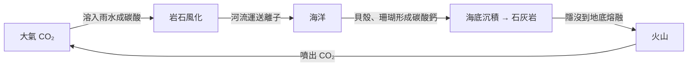

# 碳循環（carbon cycle）

> 碳在岩石、海洋、生物與大氣之間流動。慢循環以億年為尺度，像恆溫器一樣穩定地球氣候；快循環以生物壽命為尺度。人類把慢循環中累積數百萬年的碳，快速送進了快循環（[[src-nasa-carbon-cycle|NASA 碳循環]]）。

## 碳存在哪裡
地球大部分的碳（約 65,500 Gt）存在**岩石**中，其餘分布在海洋、大氣、植物、土壤與化石燃料裡（[[src-nasa-carbon-cycle|NASA 碳循環]]）。碳酸鹽岩（石灰岩）約佔含碳岩石的 80%，另外 20% 是頁岩等沉積物中的有機碳；後者的一部分在高溫高壓下變成煤、石油和天然氣。

## 怎麼運作

### 慢碳循環（1–2 億年）

- 每年約 1,000 萬–1 億公噸碳經過慢循環（[[src-nasa-carbon-cycle|NASA 碳循環]]）。
- **恆溫器機制**：CO₂ 增加 → 變暖 → 降雨增加 → 風化加快 → 更多碳沉入海底 → CO₂ 下降。這個平衡要數十萬年才能完成。
- [[coral-reef|珊瑚]]、有孔蟲、顆石藻等會造殼的生物，是現今海洋中碳酸鈣的主要生產者。
- 板塊隱沒把碳酸鹽岩帶入地底，這一步和[[plate-tectonics|板塊構造]]直接相關。

### 快碳循環（生物壽命尺度）
- 每年約 10 億–1,000 億公噸碳經過生物圈（[[src-nasa-carbon-cycle|NASA 碳循環]]）。
- 光合作用：CO₂ + H₂O + 能量 → 醣 + O₂
- 呼吸、分解、燃燒：上式反過來，把碳還給大氣。
- **地球在呼吸**：北半球陸地植物在春夏吸收 CO₂、秋冬分解釋出，大氣 CO₂ 濃度因此每年起伏，8 月降到最低，季節差約 2 ppm（[[src-nasa-carbon-cycle|NASA 碳循環]]，2010 年資料）。

### 海洋的角色
- 海洋與大氣之間不斷交換 CO₂。工業化以前兩邊大致平衡，現在海洋吸收的比釋放的多（[[src-nasa-carbon-cycle|NASA 碳循環]]）。
- 未來數千年內，海洋最終可吸收高達 85% 的化石燃料碳，但速度受限於表層與深層海水混合的快慢；[[ocean-currents|洋流]]的溫鹽環流在其中扮演關鍵角色（[[src-noaa-ocean-currents|NOAA 洋流]]）。
- 代價是[[ocean-acidification|海洋酸化]]。

## 人類如何改變碳循環
| 項目 | 數值 | 來源年份 |
|---|---|---|
| 化石燃料 CO₂ 排放 | 每年約 300 億公噸，為火山的 100–300 倍 | 約 2009 |
| 化石燃料碳排放 | 約 84 億公噸碳 | 2009 |
| 土地利用變化 | 每年接近 10 億公噸碳 | 約 2009 |
| 熱帶森林砍伐佔人為 CO₂ 排放 | 約 12% | 2008 |
| 排放的去向 | 約 45% 留在大氣、海洋吸收約 30%、陸地植物吸收約 25% | — |
| 大氣 CO₂ | 約 280 ppm → 387 ppm（+39%） | 約 2009 |

（以上皆出自 [[src-nasa-carbon-cycle|NASA 碳循環]]）

> [!note] 舊數據已更新
> 上表出自 2011 年的文章，多為 2005–2010 年的數字，保留作為歷史對照。最新觀測見下一節。

### 最新的大氣 CO₂（2026 年資料）
| 項目 | 數值 | 來源 |
|---|---|---|
| 茂納羅亞年平均 | 1959 年 315.98 → 2019 年 411.65 → **2025 年 427.35 ppm** | [[src-noaa-nasa-co2-temperature-2026\|NOAA GML]] |
| 年增量 | 2023 年 3.32、2024 年 3.33 ppm（紀錄最高）；2025 年 2.23 ppm（暫定） | [[src-noaa-nasa-co2-temperature-2026\|NOAA GML]] |
| 月平均 | 2026 年 10 月 426.69 ppm | [[src-noaa-nasa-co2-temperature-2026\|NOAA GML]] |
| 與 1750 年相比 | 約 150% | [[src-noaa-nasa-co2-temperature-2026\|NASA]] |

- 2011 年文章寫的是 387 ppm，十多年後已上升到約 427 ppm，而且近年每年增加的速度比過去更快。（綜合判斷）
- 和工業化前約 280 ppm（[[src-nasa-carbon-cycle|NASA 碳循環]]）相比，增加了約 52%，與 NASA 新頁面「約 150%」的說法一致。（推算）
- 尚缺：最新的全球化石燃料排放量（Global Carbon Project 等）。

## 認識的演進
- 南極冰芯顯示，過去 80 萬年 CO₂ 與氣溫同步起伏，這種關係一直維持到約 1900 年（[[src-nasa-carbon-cycle|NASA 碳循環]]）。
- 冰期循環主要由地球軌道週期（米蘭科維奇循環）觸發，CO₂ 的變化再把冷暖效應放大；[[last-glacial-period|末次冰期]]結束時，CO₂ 急速上升。
- 1957 年起，夏威夷 Mauna Loa 觀測站持續記錄大氣 CO₂ 濃度（[[src-nasa-carbon-cycle|NASA 碳循環]]）。

> [!question] 仍未解決的問題
> 氣溫上升後，植物吸收的碳還會多於釋放的嗎？永凍土融化會釋放多少碳？海洋吸收 CO₂ 的速度會變慢嗎？（[[src-nasa-carbon-cycle|NASA 碳循環]]）

## 相關頁面
- [[greenhouse-effect|溫室效應]] — 碳循環如何決定地球溫度
- [[ocean-acidification|海洋酸化]] — 海洋吸碳的副作用
- [[plate-tectonics|板塊構造]] — 隱沒與火山是慢循環的一環
- [[coral-reef|珊瑚礁]] — 碳酸鈣的生產者
- [[permafrost|永凍土]] — 巨大的碳庫，融化會釋放碳
- [[amoc|大西洋經向翻轉環流]] — 讓大西洋成為更有效的碳匯
