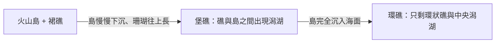

# 珊瑚礁（coral reef）

> 珊瑚礁主要由硬珊瑚分泌的碳酸鈣骨骼堆積而成，是海洋中生物多樣性最高的生態系之一，被稱為「海洋中的雨林」；約 25% 的海洋魚類仰賴健康的珊瑚礁（[[src-noaa-coral-reefs|NOAA 珊瑚礁]]）。

## 珊瑚是什麼
- 珊瑚屬於**刺胞動物**，和水母是親戚。一個珊瑚群體由成千上萬隻**珊瑚蟲**組成；每隻珊瑚蟲有一個開口，同時是嘴巴和排泄口，周圍一圈觸手上有刺細胞，用來捕食和防禦（[[src-noaa-coral-tutorial|NOAA 珊瑚教學]]）。
- 大多數珊瑚蟲在夜間進食，從浮游動物到小魚都吃；許多也會用黏液捕捉細小的有機顆粒。
- **硬珊瑚**分泌堅硬的碳酸鈣骨骼，是造礁的主力，全球約 800 種；**軟珊瑚**沒有堅硬骨骼、不造礁，但也生活在珊瑚礁中（[[src-noaa-coral-tutorial|NOAA 珊瑚教學]]）。
- 珊瑚蟲直徑平均只有 1–3 mm（[[src-noaa-coral-tutorial|NOAA 珊瑚教學]]）。

### 骨骼怎麼長出來
珊瑚蟲下半部分泌一個杯狀骨骼（萼），自己坐在杯中；每隔一段時間，珊瑚蟲會抬起身體，在舊的底板上方分泌新的底板，整個群體就這樣一層一層往上長（[[src-noaa-coral-tutorial|NOAA 珊瑚教學]]）。

| 類型 | 生長速度 |
|---|---|
| 塊狀硬珊瑚 | 每年 0.3–2 cm |
| 枝狀硬珊瑚 | 每年最多 10 cm |
| 軟珊瑚群體 | 每年 2–4 cm |

## 與共生藻的夥伴關係
- 淺海造礁珊瑚的組織裡住著會行光合作用的**共生藻**（zooxanthellae）。珊瑚提供庇護、CO₂ 和水；共生藻回報氧氣、醣類與蛋白質，並幫忙清除廢物（[[src-noaa-coral-tutorial|NOAA 珊瑚教學]]）。
- 共生藻最多可把 **90%** 的光合作用產物交給珊瑚，這是珊瑚礁能在營養貧乏的熱帶海水中如此繁盛的關鍵（[[src-noaa-coral-tutorial|NOAA 珊瑚教學]]）。
- 珊瑚的顏色主要來自共生藻。
- **深海珊瑚**沒有共生藻，靠捕食浮游生物與有機物維生，生長慢得多（[[src-noaa-coral-reefs|NOAA 珊瑚礁]]）。

> [!note] 珊瑚礁的矛盾
> 造礁珊瑚需要清澈、營養貧乏的海水，但珊瑚礁卻是地球上生產力最高、物種最多樣的海洋環境之一。共生藻的養分回收解釋了這個矛盾（[[src-noaa-coral-tutorial|NOAA 珊瑚教學]]）。

## 生長需要的條件
| 條件 | 範圍 |
|---|---|
| 水溫 | 最適 23–29°C（短時間可忍受 40°C） |
| 深度 | 多在約 30 m 以內，也就是陽光照得到的深度 |
| 鹽度 | 32–42‰ |
| 水質 | 清澈、懸浮物少 |
| 分布 | 主要在南北緯 35° 之間 |

（[[src-noaa-coral-tutorial|NOAA 珊瑚教學]]）

更深、光線較暗的「中光層」也有珊瑚，但研究很少；深海珊瑚可以生活在 4°C 的冷水中（[[src-noaa-coral-tutorial|NOAA 珊瑚教學]]）。

## 珊瑚礁的三種類型
珊瑚礁起源於自由游動的珊瑚幼生附著在島嶼或大陸邊緣的硬底上（[[src-noaa-coral-tutorial|NOAA 珊瑚教學]]）。

| 類型 | 特徵 |
|---|---|
| **裙礁** | 最常見；從岸邊直接向海延伸 |
| **堡礁** | 離岸較遠，和陸地之間隔著一片潟湖 |
| **環礁** | 火山島周圍的裙礁，在火山島沉入海面後繼續往上長，形成中間有潟湖的圓形或橢圓形礁 |

- 形成一座珊瑚礁可能要上萬年；堡礁與環礁依大小需要 10 萬到 3,000 萬年（[[src-noaa-coral-tutorial|NOAA 珊瑚教學]]）。
- 上面的演變圖依環礁的定義整理；把三者串成一個連續過程是一般地質學的說法，NOAA 頁面只有描述環礁那一步。

## 在地球系統中的角色
- **生物多樣性熱點**：西北夏威夷群島的珊瑚礁就有超過 7,000 種生物（[[src-noaa-coral-reefs|NOAA 珊瑚礁]]）。
- **碳循環**：珊瑚是製造碳酸鈣的生物之一，遺骸最後沉積成石灰岩，是慢碳循環把碳鎖進岩石的一環（[[src-nasa-carbon-cycle|NASA 碳循環]]）。見 [[carbon-cycle|碳循環]]。
- **對人類**：保護海岸、提供食物、工作、觀光與新藥來源；超過 5 億人依賴珊瑚礁（[[src-noaa-coral-reefs|NOAA 珊瑚礁]]）。

## 白化
- **機制**：珊瑚受到壓力時會排出共生藻，失去顏色而變白。白化的珊瑚還沒死，壓力不嚴重就能恢復；但共生藻離開太久，珊瑚會因缺乏養分而餓死（[[src-noaa-coral-bleaching|NOAA 珊瑚白化]]、[[src-noaa-coral-tutorial|NOAA 珊瑚教學]]）。
- **原因**：
  1. 海水升溫（首要原因，與氣候變遷有關）
  2. 逕流與汙染
  3. 高溫時日照過強
  4. 極端低潮讓珊瑚暴露在空氣中
  5. 冷水也可能造成白化：2010 年 1 月佛州礁島群的海水比平常冷 6.7°C，造成白化與部分死亡（[[src-noaa-coral-bleaching|NOAA 珊瑚白化]]）
- 共生藻有很多種，有些比較耐熱；珊瑚白化後可能換上不同的共生藻，之後也許更能抵抗白化（[[src-noaa-coral-tutorial|NOAA 珊瑚教學]]）。
- **全球白化事件**：1998、2010、[[global-coral-bleaching-2014-2017|2014–2017]]、[[global-coral-bleaching-2023-2025|2023–2025]]，最近一次是史上最大（[[src-noaa-coral-bleaching|NOAA 珊瑚白化]]）。
- 2005 年，美國在一年內失去了一半的加勒比海珊瑚礁（[[src-noaa-coral-bleaching|NOAA 珊瑚白化]]）。

## 其他威脅
- **自然**：疾病、捕食者、風暴。
- **人為**：汙染、沉積物、不永續的漁業，以及[[ocean-acidification|海洋酸化]]：海水中的碳酸根減少，珊瑚建造骨骼更困難，pH 夠低時骨骼甚至會溶解（[[src-noaa-ocean-acidification|NOAA 海洋酸化]]）。
- **復育**：把苗圃培育的珊瑚移植到受損的礁區（[[src-noaa-coral-reefs|NOAA 珊瑚礁]]）。

## 台灣
台灣海域約有 500 多種造礁珊瑚，墾丁的軟珊瑚多達 212 種（[[src-taiwan-coral-reports|台灣珊瑚報導]]）。見 [[taiwan-coral-reefs|台灣的珊瑚礁]]。

## 知識缺口
目前的資料沒有：珊瑚礁佔海洋面積的比例、珊瑚的分類學位置（綱）、白化監測用的「熱度週」定義、珊瑚的繁殖方式。

## 相關頁面
- [[taiwan-coral-reefs|台灣的珊瑚礁]]
- [[global-coral-bleaching-2014-2017|2014–2017 全球珊瑚白化事件]]、[[global-coral-bleaching-2023-2025|2023–2025 全球珊瑚白化事件]]
- [[ocean-acidification|海洋酸化]] — 威脅珊瑚骨骼
- [[carbon-cycle|碳循環]] — 珊瑚參與碳酸鈣沉積
- [[kuroshio|黑潮]] — 溫暖洋流讓珊瑚礁能分布到較高緯度
