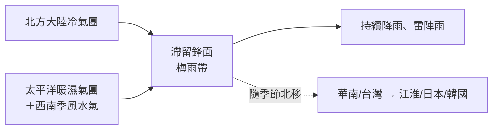

# 東亞季風與梅雨（East Asian monsoon）

> 季風是隨季節反轉方向的盛行風。東亞季風由亞洲大陸與太平洋之間的溫差驅動：冬季吹寒冷乾燥的東北風，夏季帶來溫暖濕潤的空氣；影響全球約三分之一人口（[[src-wikipedia-east-asian-monsoon|維基：東亞季風]]）。

## 為什麼會有季風
陸地升溫、降溫都比海洋快（海陸溫差）（[[src-wikipedia-east-asian-monsoon|維基]]）：
- **冬季**：大陸比海洋冷，西伯利亞高壓形成，冷空氣往海洋吹 → 東亞吹**東北季風**，寒冷乾燥；冬季季風帶來的塵埃堆積成黃土高原。
- **夏季**：大陸比海洋熱，濕潤空氣從海洋吹向陸地 → 帶來大量降雨；季風雨帶在春夏逐漸北移，7、8 月有穩定的降雨高峰。

季風偶爾「失常」，就可能造成乾旱與農作歉收。

## 梅雨：季節交替時的雨季
春夏之交，北方的冷氣團與南方太平洋的暖濕氣團勢均力敵，在交界處形成移動緩慢的**滯留鋒面**（梅雨鋒面），鋒面上常有低壓生成，帶來持續的降雨與雷陣雨（[[src-wikipedia-east-asian-monsoon|維基]]）。

梅雨帶隨季節由南往北推進，所以緯度愈高，梅雨愈晚開始：

| 地區 | 梅雨期間 |
|---|---|
| 台灣 | 約 5 月中旬–6 月中旬（平均 5 月 17 日入梅） |
| 日本九州南部 | 平均 5/30–7/15 |
| 中國長江中下游 | 平均 6/14–7/16 |
| 韓國（長雨） | 約 6/19–7 月中旬 |
| 日本東北地方 | 平均 6/15–7/28 |

（[[src-wikipedia-east-asian-monsoon|維基]]）

## 台灣的梅雨
- **入梅標準**：連續 4 天以上降雨，且 4 日平均日雨量超過 9 mm（台灣北部 5、6 月的氣候平均日雨量）的第一天。1949–2016 年統計，平均 5 月 17 日入梅，標準差 7 天（[[src-wikipedia-east-asian-monsoon|維基]]）。
- 台灣所說的「梅雨」是 5–6 月的雨季，在中國大陸稱「華南前汛期」，和 6–7 月的江淮梅雨不同。
- **季節轉換的指標**：冬季台灣附近高空吹強西風、低空吹東北季風；進入暖季後高空西風北退、低空西南季風北上。

### 異常的梅雨
| 型態 | 特徵 | 影響 |
|---|---|---|
| 空梅／短梅 | 梅雨不明顯、雨量少 | 容易乾旱 |
| 特長梅 | 雨帶停滯，總雨量可達 1,500–2,000 mm | 容易淹水 |
| 倒黃梅（重梅） | 入夏後雨帶重新南壓 | 2015、2016 年曾發生 |
| 二度入梅 | 鋒面南北來回擺盪 | — |

（[[src-wikipedia-east-asian-monsoon|維基]]）

## 和其他系統的關係
- **[[water-cycle|水循環]]**：季風是把海洋水氣大規模搬到陸地的機制；梅雨是台灣重要的降雨來源。（綜合判斷）
- **[[kuroshio|黑潮]]**：黑潮提供大量熱與水氣，影響西北太平洋的天氣（[[src-kuroshio-jma-wikipedia|黑潮資料]]）。

## 知識缺口
目前的資料沒有：台灣年雨量、梅雨與颱風各佔年雨量多少、北部與中南部的季節降雨差異、氣候變遷對梅雨的影響。這些需要中央氣象署的資料（網址失效，待找替代頁面）。

## 相關頁面
- [[water-cycle|水循環]]、[[kuroshio|黑潮]]、[[atmosphere-layers|大氣分層]]
