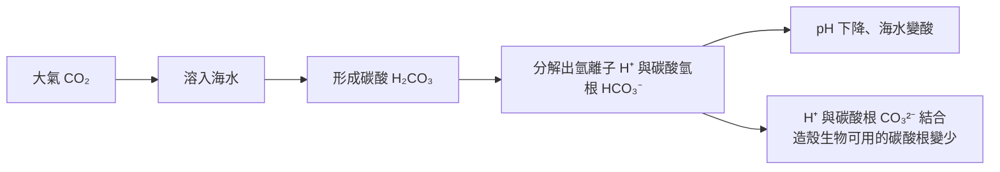

# 海洋酸化（ocean acidification）

> 海洋吸收大氣中多出來的 CO₂ 後，海水的酸度隨之上升。工業革命以來表層海水的 pH 下降了 0.1，相當於酸度增加約 30%；若排放照舊，2100 年可能從約 8.1 降到約 7.8（[[src-noaa-ocean-acidification|NOAA 海洋酸化]]、[[src-nasa-carbon-cycle|NASA 碳循環]]）。

## 怎麼運作

（[[src-noaa-ocean-acidification|NOAA 海洋酸化]]）

- 海洋吸收了約 30% 排放到大氣的 CO₂；大氣 CO₂ 愈多，海洋吸收愈多（[[src-noaa-ocean-acidification|NOAA]]、[[src-nasa-carbon-cycle|NASA]] 兩份資料一致）。

> [!note] pH 與酸度
> pH 是對數尺度，0–14，7 為中性，大於 7 為鹼性。海水目前約 8.1，仍然是鹼性；「酸化」指的是往酸的方向移動，不是已經變成酸性（[[src-noaa-ocean-acidification|NOAA]]）。

## pH 的變化
| 時間 | 表層海水 pH | 來源 |
|---|---|---|
| 工業革命以來 | 下降 0.1（酸度約 +30%） | NOAA、NASA |
| 目前 | 約 8.1 | NOAA |
| 2100 年（排放照舊） | 約 7.8 | NOAA |

- 上一次海洋 pH 這麼低，是 1,400–1,700 萬年前的中新世中期；當時地球比現在暖好幾度，也正在發生一次重大滅絕（[[src-noaa-ocean-acidification|NOAA]]）。

## 對生物的影響
| 生物 | 影響 |
|---|---|
| [[coral-reef\|珊瑚]]、牡蠣等造殼生物 | 碳酸根減少，殼與骨骼難以建造；pH 夠低時會開始溶解 |
| 翼足類（海蝴蝶，豌豆大小的海螺） | 放進 2100 年預測的海水 45 天後，殼慢慢溶解；南大洋已發現殼嚴重溶解 |
| 小丑魚 | 偵測天敵的能力變差，幼魚難找到棲地 |
| 藻類與海草 | 有些可能受益（光合作用需要 CO₂） |
| 美國西岸珍寶蟹 | 2020 年研究發現幼蟹的殼與感覺器官受影響 |

（[[src-noaa-ocean-acidification|NOAA 海洋酸化]]）

- 翼足類是從磷蝦到鯨魚許多動物的食物，牠們受害可能牽動整個食物網。
- 全球數十億人以海鮮作為主要蛋白質來源，許多漁業與經濟也仰賴魚貝類。

## 對碳循環的影響
會造殼的浮游生物與珊瑚是慢碳循環中碳酸鈣沉積的主要來源，酸化可能削弱這條把碳送入海底的路徑。（推論，見 [[carbon-cycle|碳循環]]）

> [!question] 未知
> 全球持續監測才剛起步，目前還無法準確預測酸化的影響會如何在食物網中層層擴散（[[src-noaa-ocean-acidification|NOAA]]）。

## 相關頁面
- [[carbon-cycle|碳循環]] — 海洋是人為碳的主要吸收者
- [[coral-reef|珊瑚礁]] — 受酸化威脅的代表生態系
- [[antarctic-ice-sheet|南極冰蓋]] — 南大洋已觀察到翼足類殼溶解
