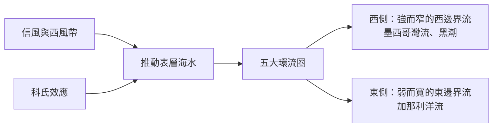
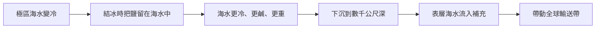

# 洋流（ocean currents）

> 洋流是海水持續且有方向的流動，可以發生在表層或深層，規模從局部到全球。主要驅動力有三種：風、海水密度與潮汐（[[src-noaa-ocean-currents|NOAA 洋流]]）。

## 兩大系統

### 表層洋流（風驅動）
- 太陽能驅動全球風系，風再推動上層約 100 m 的海水，把熱從熱帶帶往兩極（[[src-noaa-ocean-currents|NOAA 洋流]]）。
- **科氏效應**：地球自轉使風與海水偏轉，北半球向右、南半球向左。
- 代表例子：[[gulf-stream|墨西哥灣流]]、[[kuroshio|黑潮]]。

#### 艾克曼螺旋
風只推得動表層海水；表層再靠摩擦拖動下一層，每往下一層就更慢一點，也被科氏效應偏轉得更多，形成螺旋；到約 100 m 深處就停止，深層甚至可能和表層反方向流動。這個理論由瑞典科學家艾克曼在 1902 年提出（[[src-noaa-gyres-gulf-stream|NOAA 環流圈]]）。

#### 海洋環流圈（gyre）
- 風加上科氏效應，讓表層洋流在各大洋形成巨大的環狀系統：北半球順時針、南半球逆時針；赤道沒有科氏效應，所以沒有環流圈（[[src-noaa-gyres-gulf-stream|NOAA 環流圈]]）。
- 五大副熱帶環流圈：北太平洋、南太平洋、北大西洋、南大西洋、印度洋。
- 每個環流圈的**西側**是強而窄的「西邊界流」（北大西洋：墨西哥灣流；北太平洋：黑潮），**東側**是弱而寬的「東邊界流」（北大西洋：加那利洋流）。
- 「gyre」近年也常被用來指海洋垃圾聚集區，但原意是旋轉的洋流系統。

### 深層洋流：溫鹽環流（thermohaline circulation）
「溫」指溫度、「鹽」指鹽度，兩者共同決定海水密度（[[src-noaa-ocean-currents|NOAA 洋流]]）：

- 這些深層流與表層流相連，形成繞行全球的「**全球輸送帶**」，繞完一圈約需 **1,000 年**（[[src-noaa-ocean-currents|NOAA 洋流]]）。
- 它對氣候很重要，也參與營養鹽與 CO₂ 的循環（見 [[carbon-cycle|碳循環]]）。
- 輸送帶在大西洋的部分稱為**大西洋經向翻轉環流**（AMOC），佔全球溫鹽環流的一半；它是否正在減弱是目前的科學爭議焦點。見 [[amoc|大西洋經向翻轉環流]]。
- 結冰排鹽是深層水形成的關鍵，見 [[sea-ice|海冰]]。

## 湧升流（upwelling）
深層富含營養鹽的冷水被帶到表層，餵養浮游植物與海藻，成為魚類、海洋哺乳動物以至人類食物網的基礎（[[src-noaa-ocean-currents|NOAA 洋流]]）。

## 對生命的意義
對移動能力有限的海洋生物來說，洋流就像「液態的風」：運送食物與營養鹽，也散布幼生與生殖細胞（[[src-noaa-ocean-currents|NOAA 洋流]]）。

## 怎麼觀測
全球漂流浮標陣列（Global Drifter Array）、Argo 浮標；Argo 在 2018 年累積達 200 萬筆量測（[[src-noaa-ocean-currents|NOAA 洋流]]）。

## 洋流有多快
| 洋流 | 速度 | 來源 |
|---|---|---|
| 墨西哥灣流 | 平均約 6.4 km/h，最快約 9 km/h | [[src-noaa-gyres-gulf-stream\|NOAA]] |
| 黑潮 | 快處超過 2 m/s（約 7 km/h） | [[src-kuroshio-jma-wikipedia\|JMA]] |
| 深層輸送帶 | 每秒只有幾公分 | [[src-amoc-noaa-wikipedia\|NOAA]] |

## 知識缺口
目前的資料沒有涵蓋：聖嬰現象（ENSO）、海洋垃圾帶、南極繞極流。

## 相關頁面
- [[gulf-stream|墨西哥灣流]] — 北大西洋的西邊界流
- [[kuroshio|黑潮]] — 北太平洋的西邊界流，流經台灣
- [[amoc|大西洋經向翻轉環流]] — 大西洋的翻轉環流
- [[sea-ice|海冰]] — 結冰排鹽驅動深層水下沉
- [[water-cycle|水循環]] — 結冰排鹽與水的狀態變化
- [[carbon-cycle|碳循環]] — 深層海水是碳的長期儲存處
- [[glaciers-and-ice-sheets|冰川與冰蓋]] — 海冰形成驅動深層水下沉
