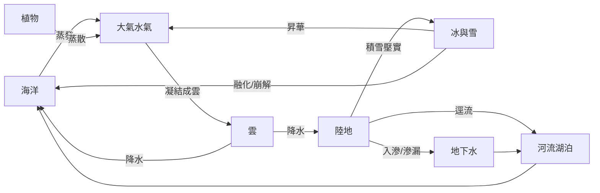

# 水循環（water cycle）

> 水在液態、固態、氣態之間不斷轉換，並在海洋、大氣、冰、陸地與生物之間持續移動。它把大氣、海洋、冰與生物串成同一個氣候系統（[[src-noaa-water-cycle|NOAA 水循環]]）。

## 是什麼
理解水循環有兩個核心概念（[[src-noaa-water-cycle|NOAA 水循環]]）：
- **水庫（pools）**：水儲存的地方與形式，例如海洋、冰川、地下水、大氣中的水氣。
- **通量（fluxes）**：水在水庫之間移動的方式，包括狀態變化。

課本常把它畫成「蒸發→凝結→降水」的簡單圓圈，但實際情況複雜得多，水在生態系中的路徑至今仍未完全了解。

## 水存在哪裡
| 水庫 | 佔比 | 來源 |
|---|---|---|
| 海洋 | 約 96.5–97% 的地球總水量 | [[src-noaa-water-cycle\|NOAA]] |
| 淡水（全部） | 2.5% 的地球總水量 | [[src-noaa-water-cycle\|NOAA]]、[[src-usgs-ice-glaciers\|USGS]] |
| └ 冰川、冰蓋、永久積雪 | 淡水的 68.7% | 兩份資料一致 |
| └ 地下水 | 淡水的 30.1% | [[src-noaa-water-cycle\|NOAA]] |
| └ 湖泊、河流、濕地 | 淡水的約 0.25% | [[src-noaa-water-cycle\|NOAA]] |

> [!note] 已裁定（2026-11-22）
> [[src-noaa-water-cycle|NOAA 水循環]] 的 97.5%（所有鹹水）、97%（取整數）、96.5%（只算海洋）定義不同，並不矛盾；精確數字採用圓餅圖的值。

也就是說，人類最常直接取用的湖泊與河流，只佔全部淡水的極小一部分。

## 怎麼運作

各種通量的定義（[[src-noaa-water-cycle|NOAA 水循環]]）：
- **蒸發**：液態水吸收能量（太陽、大氣，甚至體溫）變成水氣。
- **蒸散**：水從植物葉片蒸發；植物從根吸收的水，大部分最後都以這種方式離開。
- **凝結**：空氣中的水氣超過該溫度能容納的量時，凝成水滴，形成雲或露。
- **昇華／凝華**：冰直接變成水氣，或水氣直接變成冰（例如霜）。
- **降水、逕流、入滲、滲漏**：水落回地面，在地表流動、滲入土壤，再往下補充地下水。
- **大氣輸送**：水以氣、液、固態在大氣中移動；大氣河是其中特別集中的形式。

## 尺度
- 時間尺度：水氣在大氣中停留時間短；冰川可儲水數百年，冰蓋底部的冰可達數千年以上（[[src-usgs-ice-glaciers|USGS 冰川]]）。
- 空間尺度：從一片葉子到全球大氣河。

## 它影響什麼／被什麼影響
- **人類**：水壩、河道改道會改變水的儲存位置與數量；地下水補充很慢，用得比補得快就會耗竭（[[src-noaa-water-cycle|NOAA 水循環]]）。
- **氣候變遷**：空氣愈暖，蒸發愈多、能容納的水氣也愈多，結果是兩次降雨間隔變長、但雨下得更猛，乾旱與豪雨會同時增加。水氣本身會吸收熱，所以暖化與水氣之間形成**正回饋**（[[src-noaa-water-cycle|NOAA 水循環]]）。
- 蒸發與凝結會吸熱、放熱，因此水循環同時也在搬運能量。

## 相關頁面
- [[glaciers-and-ice-sheets|冰川與冰蓋]] — 淡水最大的儲存處
- [[greenhouse-effect|溫室效應]] — 水氣是最主要的溫室氣體
- [[ocean-currents|洋流]] — 結冰排鹽啟動溫鹽環流
- [[atmosphere-layers|大氣分層]] — 天氣與降水幾乎都發生在對流層
- [[east-asian-monsoon|東亞季風與梅雨]] — 把海洋水氣大規模送到東亞陸地
- [[sea-ice|海冰]]、[[permafrost|永凍土]] — 冰凍圈中的其他水庫
- [[sea-level-rise|海平面上升]] — 冰融化讓水從陸地移到海洋
