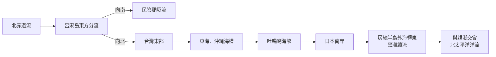

# 黑潮（Kuroshio）

> 北太平洋副熱帶環流的西邊界流：從菲律賓東方北上，流經台灣東部與日本南岸的強大暖流，是太平洋版的[[gulf-stream|墨西哥灣流]]（[[src-kuroshio-jma-wikipedia|黑潮資料]]）。

## 為什麼叫「黑潮」
黑潮的海水營養鹽與雜質很少，浮游生物也少，光線反射回水面的少，所以看起來是深藍近黑的顏色（[[src-kuroshio-jma-wikipedia|黑潮資料]]）。

## 路徑

- 分支：冬季有一部分進入台灣海峽；在東海分出台灣暖流；在九州西南分出對馬暖流進入日本海（中文維基）。
- 經呂宋海峽「入侵」南海，帶入營養鹽、提高生產力（英文維基）。

（[[src-kuroshio-jma-wikipedia|黑潮資料]]）

## 基本資料
| 項目 | 數值 | 來源 |
|---|---|---|
| 流速 | 快處超過 2 m/s | JMA |
| 寬度 | 約 100 km | JMA、英文維基 |
| 厚度 | 約 500–1,000 m | 中文維基 |
| 流量 | 台灣—與那國間約 10–23 Sv；日本東南方約 65 Sv | 維基 |
| 年平均水溫 | 約 24–26°C（冬 18–24°C、夏 22–30°C） | 維基 |

> [!note] 已裁定（2026-11-22）
> 寬度採用 JMA 與英文維基的 **約 100 km**；中文維基寫「200 多公里」。

## 西邊界流為什麼又快又窄
每個海洋環流圈的西側都是強而窄的西邊界流，東側是弱而寬的東邊界流；北大西洋的是墨西哥灣流，北太平洋的就是黑潮（[[src-noaa-gyres-gulf-stream|NOAA 環流圈]]）。至於為什麼西側特別強，目前的來源沒有解釋。

## 長期變化與大蛇行（日本氣象廳）
- 1967 年以來的流量以數年到 10 年週期起伏，1990 年代後略有減少，但**沒有顯著的長期趨勢**。
- 未來預測不一致：有研究認為到 21 世紀末無顯著變化，也有研究預測暖化會讓黑潮等西邊界流增強。
- **大蛇行**：黑潮在日本南方大幅向南彎曲的流路。1965 年以來發生 6 次，最近一次 2017 年 8 月–2025 年 4 月，長達 7 年 9 個月，是紀錄上最長的一次；大蛇行時沿岸湧起冷水塊，影響漁場。

（[[src-kuroshio-jma-wikipedia|黑潮資料]]）

## 對台灣與周邊的影響
- **熱與水氣**：把熱帶的熱往北搬，提供大量水氣，影響西北太平洋的天氣；颱風常沿著黑潮的溫暖海水北移（英文維基）。
- **漁業**：是洄游魚類的高速通道；竹筴魚的卵與稚魚從台灣東北部被帶往日本，台灣東部有旗魚、鬼頭刀等漁獲（中文維基）。
- **湧升**：黑潮流過淺灘與海山時，把深層營養鹽帶到表層；台灣東北方的湧升流提高了浮游生物量（英文維基，摘要部分）。
- **珊瑚礁**：溫暖的黑潮讓日本有珊瑚礁，英文維基稱其為世界最北的珊瑚礁。見 [[coral-reef|珊瑚礁]]、[[taiwan-coral-reefs|台灣的珊瑚礁]]。

## 知識缺口
目前的資料沒有：鹽度、進入南海的流量、黑潮對台灣氣溫與降雨的具體影響數據。中研院黑潮科普海報與台大相關論文無法讀取。

## 相關頁面
- [[ocean-currents|洋流]] — 環流圈與西邊界流
- [[gulf-stream|墨西哥灣流]] — 大西洋的對應洋流
- [[east-asian-monsoon|東亞季風與梅雨]] — 台灣周邊的大氣系統
